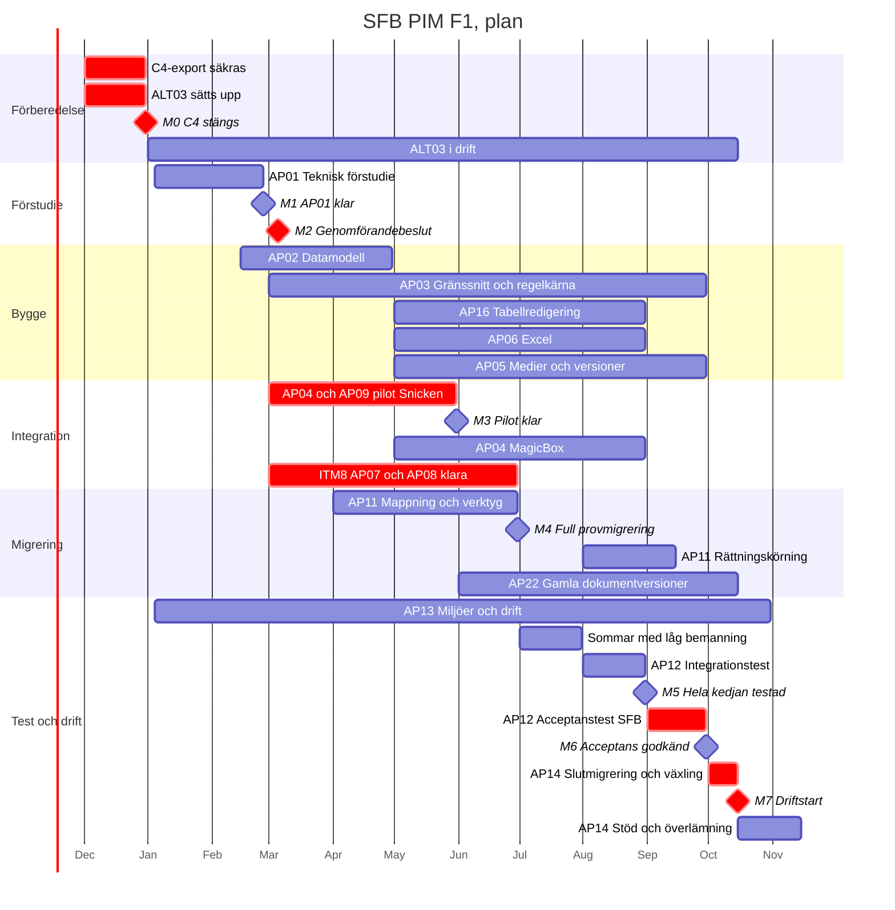

# Plan månad för månad: Symfony på Azure

Utkast för intern diskussion. Bygger på `SFB_Timestimat_Symfony_Azure.md` (normalbedömning 4 050 timmar för F1). Start i januari 2027. C4 stängs 31 december 2026.

---

## Det viktigaste först

**C4 stängs innan projektet startar.** Det ändrar förutsättningarna på tre sätt:

1. **Allt som ska följa med från C4 måste tas ut i december.** Efter 31 december finns ingen åtkomst. Det gäller data, relationer, egna texter, bilder, alla dokumentversioner och ändringsloggar. Det som inte tas ut i december är borta. Analysen av exporten (AP01) görs sedan i januari och februari på den sparade kopian.
2. **ALT03 behövs i cirka tio månader**, från januari till driftstart i oktober. Det är alltså inte en kort brygga, utan en lösning som ska fungera under hela projektet.
3. **Länkar till bilder och dokument på webben** måste fungera efter att C4 stängs, om de på något sätt är beroende av C4. Det behöver ITM8 bekräfta nu.

---

## Faser och milstolpar

| Milstolpe | När | Vad som är klart |
|---|---|---|
| **M0** | 31 dec 2026 | C4 stängt. Fullständig export sparad och kontrollerad. ALT03 i drift |
| **M1** | slutet av feb | AP01 klar: fältmatris, kontrakt, Excel-mall, exportanalys, reviderat estimat |
| **M2** | början av mars | SFB:s genomförandebeslut och bindande pris |
| **M3** | slutet av maj | AP09-piloten klar: första externa kopplingen fungerar i testmiljön |
| **M4** | slutet av juni | Alla funktioner byggda i första version. Full provmigrering körd |
| **M5** | slutet av aug | Hela kedjan testad med ITM8 och Snicken |
| **M6** | slutet av sep | SFB:s acceptanstest godkänt. Återställningsprov klart |
| **M7** | mitten av okt | Driftstart F1. ALT03 avvecklas |
| **M8** | mitten av nov | Stödperiod slut. Överlämning klar |

---

## Tidslinje

---

## Månad för månad

### December 2026: förbered stängningen (ALT03)
- SFB beställer fullständig export av C4 från nuvarande ansvarig. Vaimo specificerar vad som ska med.
- Exporten kontrolleras att den går att läsa och är komplett, innan C4 stängs.
- ALT03 sätts upp tillsammans med ITM8 (se nedan).
- SFB beställer AP01, så att arbetet kan starta i januari.

### Januari: AP01 startar
- Fältmatris, identiteter och kontrakt med ITM8 och Snicken.
- Analys av den sparade C4-exporten.
- Azure-miljö och åtkomst sätts upp (AP13).

### Februari: AP01 avslutas
- Excel-mall, medieinventering, reviderat estimat och plan.
- Datamodellen påbörjas i slutet av månaden, om SFB godkänner det innan beslutet.
- **M1:** AP01 klar.

### Mars: beslut och start av bygget
- **M2:** SFB beslutar om genomförande.
- Datamodell och regelkärna byggs.
- **AP09-piloten startar** (se nedan).

### April: regelkärna och pilot
- Gränssnittet för artiklar, sök och grupper.
- Piloten testas mot Snicken med data från C4-exporten.
- Migreringsmappning startar.
- SFB:s administratörer granskar gränssnittet varannan vecka.

### Maj: piloten klar, bredare bygge
- **M3:** första externa kopplingen fungerar. Mönstret återanvänds för MagicBox.
- Tabellredigering, Excel och medier startar.
- Integration mot MagicBox startar.

### Juni: allt byggt i första version
- Alla funktioner i första version. Högsta bemanningen.
- ITM8:s källkopplingar och MagicBox-anslutning ska vara klara.
- **M4:** full provmigrering.

### Juli: sommar
- Låg bemanning hos alla parter. Inga tester med SFB.
- Felrättning, prestandatest internt, förberedelse av rättningskörning.

### Augusti: hela kedjan
- Integrationstest med ITM8 och Snicken.
- Rättningskörning av migreringen. Gamla dokumentversioner körs.
- **M5:** hela kedjan testad.

### September: acceptans
- SFB:s administratörer testar alla huvudflöden.
- Första utbildningen. Återställningsprov.
- Felrättning och omtest.
- **M6:** acceptans godkänd.

### Oktober: driftstart
- Andra utbildningen. Slutmigrering. SFB fattar beslut om driftstart.
- **M7:** F1 i drift, ALT03 avvecklas.
- Tio dagars förstärkt stöd startar.

### November: avslut
- Stöd avslutas, överlämning klar.
- **M8:** projektet avslutat.

---

## Timmar per månad och paket (normalbedömning)

| Paket | Jan | Feb | Mar | Apr | Maj | Jun | Jul | Aug | Sep | Okt | Nov | Summa |
|---|---:|---:|---:|---:|---:|---:|---:|---:|---:|---:|---:|---:|
| AP01 Förstudie | 120 | 100 | | | | | | | | | | 220 |
| AP02 Datamodell | | 20 | 110 | 60 | | | | | | | | 190 |
| AP03 Gränssnitt och regelkärna | | | 100 | 140 | 140 | 120 | 40 | 60 | 60 | | | 660 |
| AP16 Tabellredigering | | | | | 60 | 100 | 30 | 50 | | | | 240 |
| AP06 Excel | | | | | 40 | 80 | 20 | 40 | | | | 180 |
| AP04 Integration (inkl. pilot) | | | 60 | 90 | 80 | 100 | 20 | 60 | | | | 410 |
| AP05 Medier och versioner | | | | | 50 | 100 | 40 | 60 | 40 | | | 290 |
| AP11 Migrering | | | | 40 | 60 | 80 | 20 | 70 | 40 | 80 | | 390 |
| AP22 Gamla dokument | | | | | | 30 | | 50 | 40 | 40 | | 160 |
| AP12 Test och acceptans | | | | 20 | 20 | 30 | 20 | 100 | 160 | 70 | | 420 |
| AP13 Miljöer och drift | 40 | 30 | 30 | 10 | 10 | 20 | | 20 | 50 | 30 | | 240 |
| AP14 Växling och överlämning | | | | | | | | | 40 | 120 | 60 | 220 |
| AP15 Projektledning | 40 | 40 | 45 | 45 | 50 | 50 | 20 | 45 | 50 | 40 | 5 | 430 |
| **Summa** | **200** | **190** | **345** | **405** | **510** | **710** | **210** | **555** | **480** | **380** | **65** | **4 050** |
| **Ungefär antal heltidspersoner** | 1,5 | 1,5 | 2,5 | 3 | 3,5 | 5 | 1,5 | 4 | 3,5 | 3 | 0,5 | |

Heltid räknas som cirka 140 debiterbara timmar per månad. ALT03 ligger utanför tabellen.

---

## Beroenden

| # | Vem | Vad | Senast | Om det inte håller |
|---|---|---|---|---|
| B1 | SFB | Beställa fullständig C4-export | början av dec | Data går förlorad för gott |
| B2 | Nuvarande C4-ansvarig | Leverera och kontrollera exporten | 20 dec | Data går förlorad för gott |
| B3 | ITM8 | ALT03 i drift, länkar till bilder och dokument fungerar efter stängningen | 31 dec | Mottagarna får ingen data, webben tappar bilder |
| B4 | SFB | Beställa AP01 | mitten av dec | Start skjuts fram, allt flyttas lika mycket |
| B5 | SFB | Azure-prenumeration, Entra ID-åtkomst | början av jan | AP13 försenas |
| B6 | ITM8 | Underlag om MagicBox, Finfo, BASTA och BVB för kontrakten | januari | AP01 försenas |
| B7 | SFB | Genomförandebeslut | 5 mars | Varje veckas väntan flyttar driftstart en vecka |
| B8 | Snicken | Urvalsformat, testmiljö och kontaktperson för piloten | början av mars | Piloten flyttas, MagicBox-kopplingen får inget beprövat mönster |
| B9 | SFB | Administratörer tillgängliga cirka fyra timmar i veckan för granskning | april till juni | Gränssnittet blir fel och måste göras om |
| B10 | SFB | Beslut om migreringsurval | 1 juni | Provmigreringen körs på fel urval |
| B11 | ITM8 | Källkopplingar och MagicBox-anslutning (AP07, AP08) klara för test | 30 juni | Integrationstestet i augusti flyttas, driftstart flyttas |
| B12 | ITM8 och Snicken | Medverka i integrationstest | augusti | Driftstart flyttas |
| B13 | SFB | Administratörer på heltid för acceptanstest | september | Driftstart flyttas |
| B14 | SFB | Beslut om driftstart | början av okt | ALT03 måste förlängas |

---

## AP09 som pilot för externa kopplingar

**Idén:** bygg kopplingen till Snicken först, som ett litet men komplett exempel på hur en extern koppling ska fungera. När den fungerar återanvänds samma mönster för MagicBox, som är större och mer kritisk.

**Varför Snicken passar**
- Mindre volym än MagicBox, eftersom Snicken bara vill ha ett urval.
- Innehåller alla svåra delar: första fullständiga leverans, sedan bara ändringar, egen position i flödet, kvittens, omsändning, besked när en artikel lämnar urvalet och ändrad livscykelstatus.
- Ett fel drabbar en mottagare, inte hela distributionen.
- Snicken har ingen leverans från PIM idag att jämföra med, så det finns inget gammalt beteende att efterlikna.

**Vad piloten ska bevisa**
1. Kontraktsformatet från AP01 fungerar i praktiken.
2. Ändringsflödet ut från PIM (del av AP04) är korrekt och kan återanvändas.
3. Felhantering, omsändning och återstart efter avbrott fungerar.
4. Samarbetet mellan Vaimo, ITM8 och Snicken fungerar innan det blir kritiskt.

**Kräver:** att piloten körs på data från C4-exporten, eftersom PIM inte har riktig data än i mars.

**Öppen fråga:** i grundupplägget bygger ITM8 AP09. Om Vaimo ska bygga piloten tillkommer cirka 150 till 350 timmar (normalt cirka 220), som inte finns med i estimatet ovan. Det kan också delas: Vaimo bygger PIM:s sida och ITM8 bygger Snickens adapter.

---

## ALT03: tio månader utan C4

Kravspecen ger inte ALT03 någon färdig utformning. Det finns tre nivåer att välja mellan:

| Nivå | Innehåll | För SFB | Arbete |
|---|---|---|---|
| **A. Frysning** | MagicBox fortsätter skicka den sista datan från C4. Ingenting uppdateras | Inga nya artiklar, inga ändringar i tio månader. Troligen inte acceptabelt | Litet |
| **B. Källflöde direkt** | ITM8 kopplar källorna (Finfo, BASTA, BVB) till MagicBox tidigt. Källdata går ut tillsammans med SFB:s frysta egna texter | Källdata hålls aktuell. SFB kan inte berika eller skapa egna artiklar | Mest ITM8, Vaimo hjälper med de frysta egna värdena |
| **C. Källflöde plus enkel manuell hantering** | Som B, plus ett enkelt sätt att skapa och rätta artiklar, till exempel via Excel in i MagicBox | Det mest nödvändiga arbetet kan fortsätta | Mer arbete, mest ITM8 |

**Rekommendation:** nivå B som grund och C om SFB behöver kunna skapa egna artiklar under perioden. Det är en verksamhetsfråga för SFB.

**Uppskattning för Vaimos del av nivå B:** 120 till 350 timmar (normalt cirka 200). Det omfattar specifikation och kontroll av C4-exporten i december, att ta fram de frysta egna värdena till MagicBox, samordning och viss uppföljning under perioden. ITM8:s arbete tillkommer och blir troligen större.

**Viktigt:** om ITM8 kopplar källorna till MagicBox redan i december, då är det i praktiken AP07 som görs tidigt. Det minskar risken i F1 senare, men ITM8 hinner det troligen inte på sex veckor. Det behöver stämmas av med ITM8 omedelbart.

---

## Risker i planen

| Risk | Påverkan | Åtgärd |
|---|---|---|
| C4-exporten är ofullständig | Data går förlorad, AP11 och AP22 blir dyrare eller omöjliga | Specificera exporten noga, kontrollera före 20 december |
| ALT03 hinner inte bli klar till 31 december | Mottagarna får ingen ny data | Börja med nivå A som golv, bygg ut till B i januari |
| Genomförandebeslutet dröjer | Hela planen flyttas | Be SFB om beslutsdatum redan nu. Låt datamodell och miljöer fortsätta under beslutet |
| ITM8 blir försenade med AP07 och AP08 | Integrationstestet flyttas från augusti | Piloten mot Snicken ger ett beprövat mönster. Följ upp ITM8 varje månad |
| Sommaren | Juli ger lite framdrift | Planen räknar redan med det |
| Juni har hög belastning | Svårt att bemanna fem personer | Kan jämnas ut genom att starta medier och Excel i april |
| Bara en månad acceptanstest | Liten marginal före driftstart | Den hårda gränsen är inte längre C4 utan hur länge ALT03 håller. Driftstart kan flyttas till november om det behövs |

---

## Öppna frågor

1. Ska Vaimo bygga AP09-piloten, eller ITM8?
2. Vilken nivå av ALT03 behöver SFB?
3. Har ITM8 kapacitet att göra något i december?
4. Vem tar ut C4-exporten, och har den personen fått beställningen?
